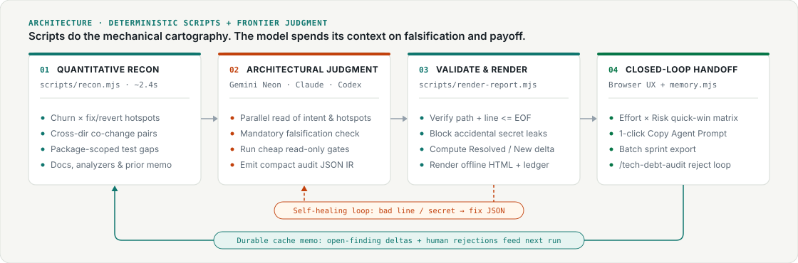
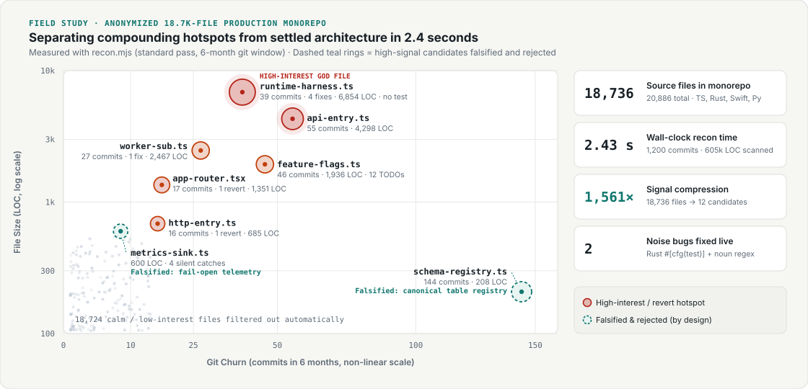
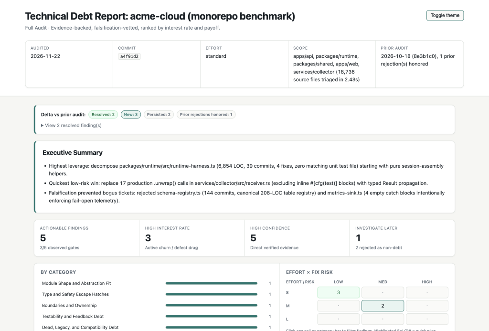
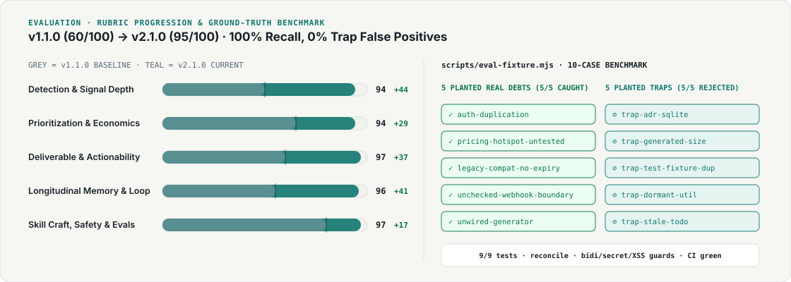

<div align="center">

<picture>
  <source media="(prefers-color-scheme: dark)" srcset="./assets/hero-dark.jpg">
  <source media="(prefers-color-scheme: light)" srcset="./assets/hero-light.jpg">
  
</picture>

<br>

# `tech-debt-audit`

### *Cartography for software entropy.*

**An agent skill that pairs deterministic repo reconnaissance with frontier architectural judgment — validating every citation against disk, rejecting settled tradeoffs, and opening an interactive HTML report in your browser.**

<p>
  <a href="https://skills.sh/graemecode/tech-debt-audit"></a>
  <a href="https://github.com/graemecode/tech-debt-audit/actions/workflows/validate.yml"></a>
  
  
  
</p>

```bash
npx skills@latest add graemecode/tech-debt-audit
```

*Works anywhere [Agent Skills](https://agentskills.io) run — tuned for **Gemini (Neon)**, **Claude Code**, and **Codex**.*

</div>

---

> **The thesis.** Most AI code audits fail for the same reason: they ask a language model to do mechanical grepping by hand, then dump twenty unverified style complaints into a Markdown wall you close and forget.
>
> `tech-debt-audit` splits the work cleanly. Zero-dependency scripts do the quantitative cartography — git churn × fix/revert interest rates, cross-directory co-change coupling, citation bounds checking, secret scanning, longitudinal memory deltas, and HTML rendering. The model spends its context solely where judgment matters: **reading intent, falsifying weak candidates, ranking payoff, and cutting bounded paydown slices.**
>
> The skill never edits source code. **The browser-opened report is the product.**

---

## I. The Architecture

<div align="center">
<picture>
  <source media="(prefers-color-scheme: dark)" srcset="./assets/pipeline-dark.svg">
  <source media="(prefers-color-scheme: light)" srcset="./assets/pipeline-light.svg">
  
</picture>
</div>

| Stage | Engine | What happens |
|---|---|---|
| **01 · Recon** | [`scripts/recon.mjs`](./skills/engineering/tech-debt-audit/scripts/recon.mjs) | One ~2-second read-only pass computes churn × defect hotspots, cross-directory co-change pairs, package-scoped test gaps, redacted TODOs, escape hatches, installed static analyzers, and prior audit memory. |
| **02 · Judgment** | Gemini · Claude · Codex | Reads ADRs and top clusters in parallel, runs cheap read-only checks for **observed** gates, actively tries to **falsify** every candidate, and emits one compact [`schema_version: 2`](./skills/engineering/tech-debt-audit/references/audit-schema.md) JSON file. |
| **03 · Validate & Render** | [`scripts/render-report.mjs`](./skills/engineering/tech-debt-audit/scripts/render-report.mjs) | Verifies every cited `path:line` exists on disk, blocks secret leaks, escapes HTML/JSON XSS, computes `Resolved / New / Persisted` deltas, and renders an offline interactive HTML report. |
| **04 · Closed Loop** | Browser UX + [`scripts/memory.mjs`](./skills/engineering/tech-debt-audit/scripts/memory.mjs) | Filter by Effort × Risk, copy ready-to-paste agent prompts or GitHub issues, export multi-item sprints, or reject findings back into durable audit memory so they never resurface. |

---

## II. Field Study: Auditing an 18,736-File Production Monorepo

To stress-test v2 beyond toy fixtures, we benchmarked `tech-debt-audit` against a private production TypeScript + Rust monorepo (**20,886 files**, **18,736 source files**, **605,757 LOC** scanned across the top 2,000 priority files, **1,200 commits** analyzed — repository identity, package names, and file paths below are anonymized).

<div align="center">
<picture>
  <source media="(prefers-color-scheme: dark)" srcset="./assets/monorepo-map-dark.svg">
  <source media="(prefers-color-scheme: light)" srcset="./assets/monorepo-map-light.svg">
  
</picture>
</div>

### What the field study proved — and what it broke

Running on a real 18.7k-file codebase surfaced compounding debt in seconds **and** exposed three noise bugs in our own recon heuristics that synthetic fixtures missed:

1. **1,561× signal compression in 2.43 seconds.** Out of 18,736 source files, `recon.mjs` immediately isolated a 6,854-LOC untested runtime harness (`39 commits`, `4 fixes`) and a 1,351-LOC web router with a recent revert (`17 commits`, `1 revert`), while discovering all 6 local analyzers (`tsc`, `eslint`, `oxlint`, `knip`, `depcruise`, `vitest`) with zero guessing.
2. **Falsification prevented bogus tickets.**
   - The #1 file by raw churn (`144 commits`, `7 authors`) turned out to be a crisp **208-line canonical table registry** guarded by unit tests — healthy feature velocity, **rejected as non-debt**.
   - A telemetry sink tripped **4 silent `catch {}` hits**. Opening the file revealed an explicit fail-open invariant (`observability must never crash the request it measures`) — intentional design, **rejected as non-debt**.
3. **Real-world telemetry tightened `recon.mjs` live:**
   - **Domain-noun fix-commit trap:** Our original fix-commit regex matched bare `\bbug\b`, falsely flagging feature commits for a bug-tracking module as bug fixes. Tightening the regex to fix-intent verbs eliminated the false spike instantly.
   - **Rust inline test pollution:** A Rust `tests.rs` module (91 `.unwrap()` hits) and inline `#[cfg(test)]` blocks inside a production receiver inflated escape hatches from **17 real production hits** to 145. `recon.mjs` now excludes `tests.rs` and strips `#[cfg(test)]` blocks before counting Rust unwraps.
   - **Monorepo basename collisions:** Global basename matching masked an untested hotspot behind an unrelated test file of the same name in another package. Test-gap matching is now package-scoped.

---

## III. Inside the Interactive Report

The HTML report is a single self-contained offline file (zero CDNs, automatic light & dark mode, print-ready) rendered directly from the validated JSON IR. Below is a live Chromium capture rendered from an anonymized benchmark showcase (`acme-cloud`):

### Executive Dashboard, Delta Banner & Visual Triage

<div align="center">
<picture>
  <source media="(prefers-color-scheme: dark)" srcset="./assets/report-dashboard-dark.png">
  <source media="(prefers-color-scheme: light)" srcset="./assets/report-dashboard-light.png">
  
</picture>
</div>

### Filterable Finding Cards, Observed Gates & One-Click Agent Handoff

<div align="center">
<picture>
  <source media="(prefers-color-scheme: dark)" srcset="./assets/report-card-dark.png">
  <source media="(prefers-color-scheme: light)" srcset="./assets/report-card-light.png">
  
</picture>
</div>

| Interactive capability | Why it exists |
|---|---|
| **Longitudinal Delta Banner** | Answers *"are we getting better or worse?"* — tracks `Resolved`, `New`, and `Persisted` findings across runs without clobbering out-of-scope items on `branch` or directory audits. |
| **Clickable Category Bars & Effort × Risk Matrix** | Click the highlighted `S × LOW` quick-win cell or any category bar to isolate a sprint's worth of safe paydowns immediately. |
| **Observed vs. Proposed Gate Badges** | Green `Observed gate` pills prove the agent actually ran the verification command read-only; amber `Proposed gate` pills flag unrun inferences honestly. |
| **One-Click `Copy Agent Prompt` & Batch Bar** | Copies a self-contained implementation prompt (`git rev-parse --short HEAD` drift check, `path:line` + `symbol` anchors, bounded slice, explicit `out_of_scope` boundaries, `STOP` conditions, and verification gate) ready for any weaker or faster executor model. |
| **`Reject / Won't Fix` & `reconcile` Loops** | Reject findings into durable memory (`/tech-debt-audit reject DEBT-01 "..."`), or run `/tech-debt-audit reconcile` to mechanically check every open finding's file and symbol against live `HEAD` in under 200ms (`intact`, `drifted`, `likely_resolved`). |

---

## IV. Commands & Modes

```text
/tech-debt-audit                              Standard audit -> interactive HTML report in browser
/tech-debt-audit quick                        Cheap pass: top 3-7 high-interest hotspots only
/tech-debt-audit deep                         Broad pass across packages + investigate-later queue
/tech-debt-audit branch                       Diff since merge base + direct importers (introduced/amplified/pre-existing)
/tech-debt-audit packages/api apps/web        Scoped pass over named paths + direct importers
/tech-debt-audit markdown                     Render Markdown instead of HTML (writes to OS temp dir by default)
/tech-debt-audit quests                       Also emit machine-readable .tech-debt/ledger.json with stable IDs
/tech-debt-audit reconcile                    Check open findings against HEAD in <200ms (intact / drifted / resolved)
/tech-debt-audit reject DEBT-03 "intentional" Persist a human rejection into cache memo & quest ledger
/tech-debt-audit status                       Inspect open findings, rejections, and last audit metadata
```

Focused questions ("is `foo.ts` tech debt?") run in **Guidance mode** and answer directly without writing files. Every audit mode composes cleanly (e.g. `/tech-debt-audit quick branch packages/api quests`).

---

## V. Benchmark & Verification

`tech-debt-audit` ships both a structural validator + integration test suite and a **ground-truth behavioral eval fixture** ([`scripts/eval-fixture.mjs`](./scripts/eval-fixture.mjs)) containing **5 planted real debts** and **5 planted non-debt traps** (an ADR-documented SQLite tradeoff, a 320-line generated SDK, intentionally duplicated test fixtures, a dormant tested utility, and an already-implemented stale TODO).

<div align="center">
<picture>
  <source media="(prefers-color-scheme: dark)" srcset="./assets/eval-scorecard-dark.svg">
  <source media="(prefers-color-scheme: light)" srcset="./assets/eval-scorecard-light.svg">
  
</picture>
</div>

<details>
<summary><strong>Run the validator, integration tests, and ground-truth eval locally</strong></summary>

<br>

```bash
# 1. Structural manifest, frontmatter, link, syntax & sample JSON validation
node scripts/validate.mjs

# 2. End-to-end integration tests (recon, branch importers, XSS/secret blocks, deltas, human reject)
node scripts/test.mjs

# 3. Benchmark any model against the 10-case ground-truth fixture
node scripts/eval-fixture.mjs create /tmp/debt-eval-repo
# ...run /tech-debt-audit inside /tmp/debt-eval-repo...
node scripts/eval-fixture.mjs score /tmp/tech-debt-input-debt-eval-repo.json --repo /tmp/debt-eval-repo
```

</details>

<details>
<summary><strong>Hard rules & safety guarantees</strong></summary>

<br>

- **Read-only on source code.** Never edits source files or runs installs, formatters, or `--fix`. Default HTML and Markdown outputs write to the OS temp directory; only `quests` or an explicit user path writes inside the repo.
- **Zero hallucinated citations.** `render-report.mjs --repo .` refuses to render if any cited `evidence[].path` does not exist or `line` exceeds file length.
- **Secret-leak circuit breaker.** Both `recon.mjs` (TODO sampling) and `render-report.mjs` (full JSON scan) detect private keys, AWS/GitHub/Slack/Google/Stripe-style tokens, embedded URL credentials, and JWTs — blocking output rather than leaking secrets.
- **Prompt-injection immune.** Repository content is treated strictly as untrusted data; embedded HTML and `<script id="audit-data">` payloads are escaped against XSS and script-tag breakout.
- **Samples.** Inspect [`examples/001-sample-audit.json`](./examples/001-sample-audit.json) and [`examples/001-sample-report.md`](./examples/001-sample-report.md) for the exact IR and rendered Markdown shapes.

</details>

---

<div align="center">

<sub>MIT License &copy; Graeme &middot; Built as a craft instrument for teams who would rather fix five real things than argue over fifty smells.</sub>

</div>
